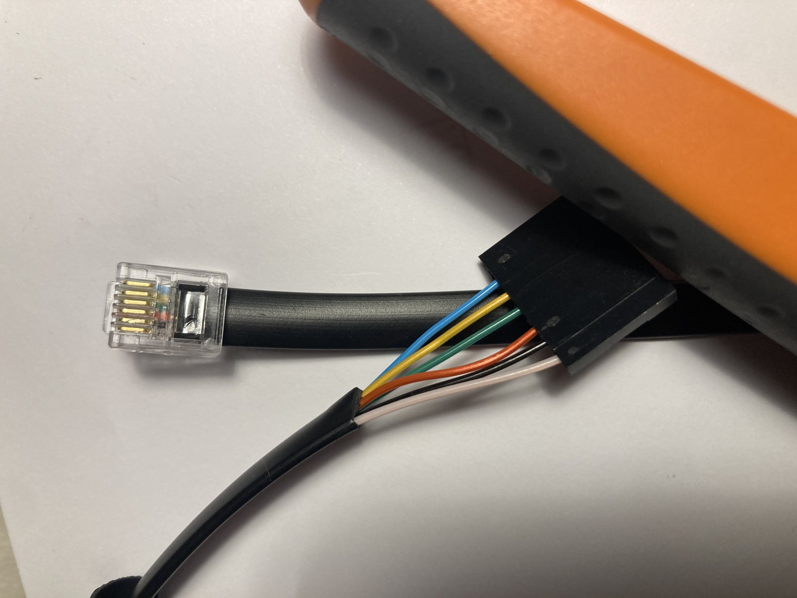
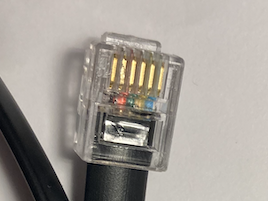
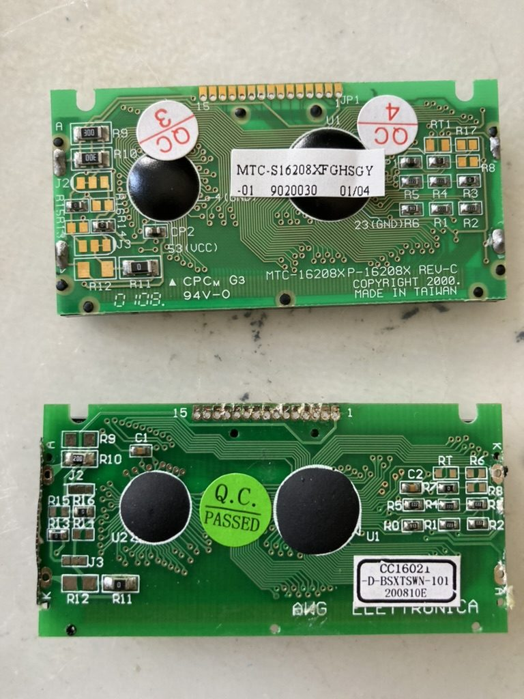
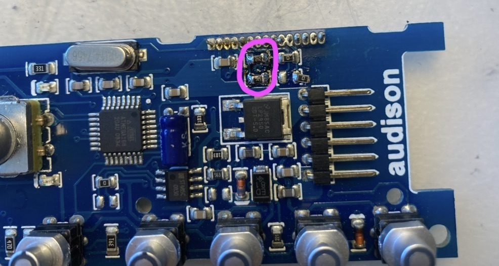

A while ago I bought a cheap, used Audison Bit One with a DRC, but without the cable included. The first step was to put together a cable, but then it turned out that the LCD display of the unit doesn’t work well (most lines were dead) and needed replacement.

## DIY DRC cable

The DRC cable is a standard RJ-11 telephone cable with a 7-pin 2.54mm female header connector on the other end.

It actually uses 6 wires and one location in the female header remains empty (it should actually be blocked with something, as it acts as a polarity key to avoid plugging in the connector the wrong way).

[{: width="1600" height="1200"}](originals/Untitled.jpg)

When plugged into the DRC, the ordering of colors looks as follows:

[{: width="1600" height="1200" loading="lazy"}](originals/Untitled%201.jpg)

<aside class="callout" markdown="1">
⚠️ Depending on the RJ-11 cable type (straight or crossed), the order of wires in the RJ-11 plug might differ. Getting it wrong might fry your DRC and/or the DSP.

My RJ-11 plug:

[{: width="268" height="201" loading="lazy"}](originals/Untitled.png)

</aside>

## DRC display replacement

My DRC display had a serious issue - most of the lines in the display didn’t work. This is usually caused by the conductive tape between the display PCB and the actual display not making proper contact. All my attempts to reglue the tape failed.

So, googling a bit, I came across a website in Russian describing the replacement procedure using a Winstar WH1602S display:

[https://www.drive2.ru/c/535431927230890703/](https://www.drive2.ru/c/535431927230890703/)

In the meantime, those displays have become hard to find, but you can buy an equivalent **NMTC-S16208X** display, e.g. from Mouser. It is black text on green, but I haven’t managed to find a replacement with a blue color.

A few things need to be adjusted though - there are some differences between the displays (top - new one, bottom - original from the DRC):

[{: width="768" height="1024" loading="lazy"}](originals/Untitled.jpeg)

### Adjustment #1: Polarity of the backlight

It is set by 0-ohm 0603 resistors R13-16. In the case of my display, they had to be reconfigured to match the original display configuration - R16 and R13 should be populated.

### Adjustment #2: Series resistors of the backlight

Only after measuring a bit more I realized that R9 and R10 are wired in parallel and are in series with the LEDs providing backlight of the display. In the end, it was fine to leave 2x300Ω 1206 resistors in parallel, yielding 150Ω resistance and decent power handling capability.

### Adjustment #3: Contrast

Contrast adjustment is done via resistors on the main DRC board.

[{: width="986" height="527" loading="lazy"}](originals/D772F307-A1B9-4F17-AAE1-2EC1CF9FBFA1_1_105_c.jpeg)

They are a simple voltage divider between GND and VCC. What worked well for me (sorry for the messy soldering, it was just a test):

[{: width="343" height="356" loading="lazy"}](originals/Untitled%201.png)

So 2.4kΩ for the top resistor and 560Ω for the bottom one.

### Final result

And… it’s running!

[{: width="1600" height="1200" loading="lazy"}](originals/Untitled%202.jpg)
