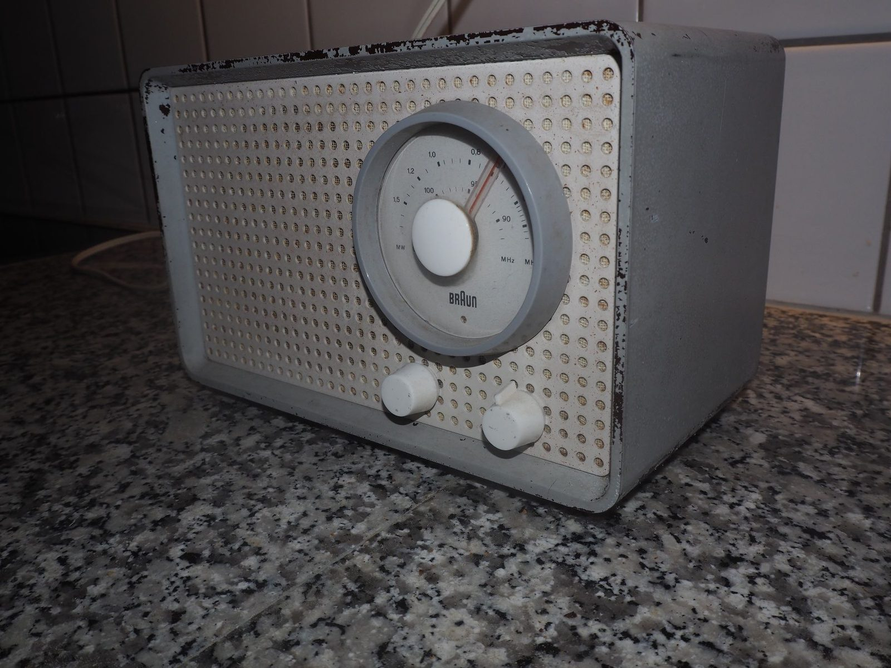
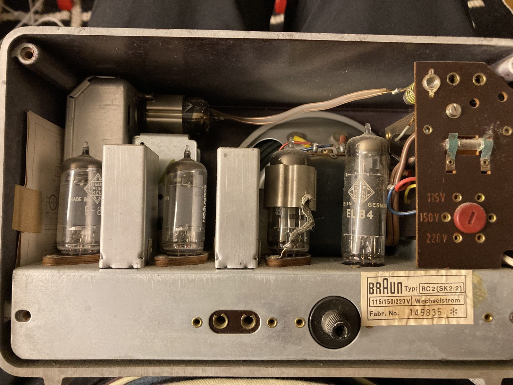
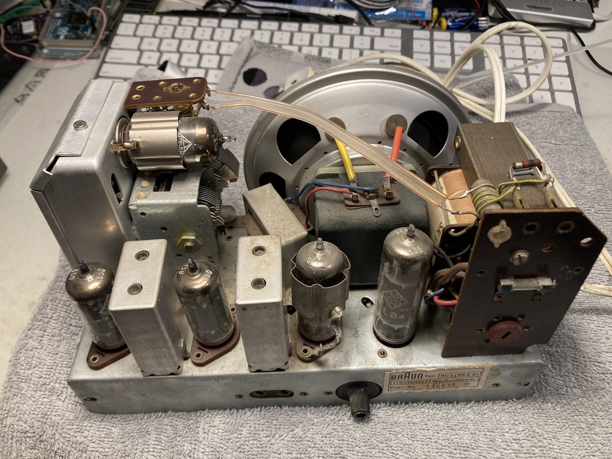
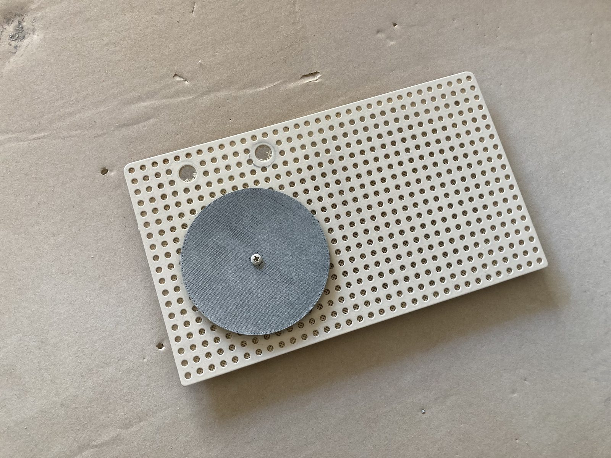
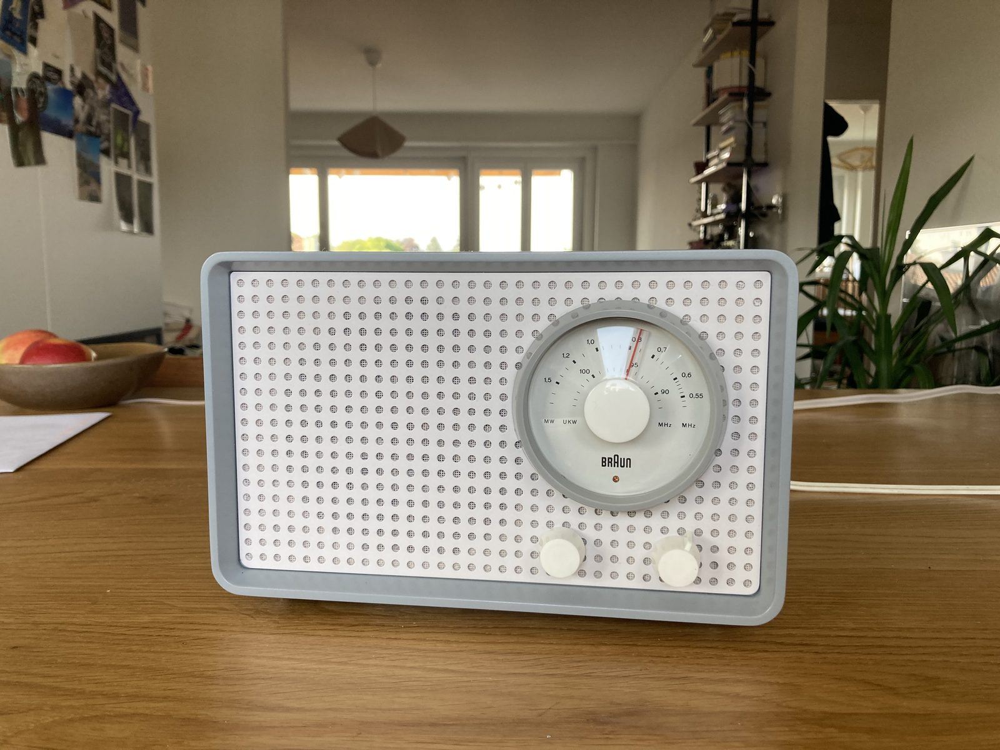

Ever since I first saw one (probably in the early 2000s), Braun SK “kitchen” radios have struck me with their minimalism, beautiful simple design and focus on easy interaction. Not knowing much about the history of Braun at the time (probably when I was 16 or 18 years old), they felt so fresh compared to the usual tube radios and resembled Apple products in terms of industrial design.

Funnily enough, only later did I learn how much Apple designs were influenced by the Braun design department and how influential Dieter Rams was (even though he joined Braun after the SK series was designed).

So… years later, when a nice and complete SK2/2 popped up on a local classifieds site, I had no choice but to get it 😇

## Initial state

The unit I purchased came in a surprisingly nice state given it is over 60 years old. The very good news is that it was complete, no parts were missing and also the brittle bakelite case had no chips or cracks.

[{: width="1600" height="1200"}](originals/2-radios-braun-vintage.jpeg)

The internals looked extremely clean as well. It seems nobody had been inside before and that the unit has spent a big part of its life in storage, without even collecting that much dust:

[{: width="1600" height="1200" loading="lazy"}](originals/IMG_0141.jpeg)

[{: width="1600" height="1200" loading="lazy"}](originals/IMG_0155.jpeg)

## Recapping: paper capacitors and the selenium rectifier

Before connecting the unit to power, there are two spots that require particular attention on Braun SK2/2:

- Capacitors
- Selenium rectifier diode

Especially the paper capacitors are dangerous, as they leak, lose capacitance or short, which might lead to fires and definitely can overload the rectifier diode. Those go out:

[{: width="1600" height="1377" loading="lazy"}](originals/IMG_1109.jpeg)

The selenium rectifier might go bad, either with a big poof or simply by increasing its resistance, which both makes it very hot and increases the voltage drop (and hence lowers the voltages). In my unit the voltages seemed fine and I decided to keep the selenium component.

I replaced the capacitors and tried to keep them in their original locations, without altering the original routing, to preserve originality:

[{: width="1600" height="1200" loading="lazy"}](originals/IMG_1116.jpeg)

Most of the new capacitors are foil and axial, making them look almost original.

## Repainting the case: RAL 7040 and RAL 9003

I was more worried about the case. How to strip the original paint without damaging the material? How to paint it to make it look nice?

Stripping turned out to be extremely easy. Hot water from a shower head combined with a non-abrasive sponge made the original paint just come off easily and cleanly - here halfway through:

[{: width="1600" height="1200" loading="lazy"}](originals/IMG_1183.jpeg)

What a joy, the original paint just comes off in hot water with a little bit of scrubbing using a normal sponge.

For the paint, I used a RAL paint color fan to pick the right colors and the result was:

- For the case: RAL 7040 (Fenstergrau) in satin-gloss finish, it’s really a perfect match and someone else in one of the German vintage radio forums reported the same
- For the front plate: RAL 9003 (Signalweiss) in satin-matt finish

I ordered both paints in spray cans but as a two-component paint (2K) from [https://spraydosenshop.de/](https://spraydosenshop.de/). The 2K paint cures via a chemical reaction, making the final result more resistant to wear and various substances.

Before painting, I also measured the dial (80x12.5mm) and printed a small ring to cover it (it is glued and I didn’t want to destroy it when attempting a disassembly):

[{: width="1600" height="1200" loading="lazy"}](originals/IMG_1117.jpeg)

[{: width="1600" height="1200" loading="lazy"}](originals/IMG_1118.jpeg)

So here we go:

[{: width="1600" height="1200" loading="lazy"}](originals/IMG_1422.jpeg)

Painting the front plate with the dial covered by a 3D-printed ring

[{: width="1600" height="1426" loading="lazy"}](originals/IMG_1424.jpeg)

Case was painted hanging from the ceiling

[{: width="1200" height="1600" loading="lazy"}](originals/IMG_1495.jpeg)

Ready to assemble!

## Final result

The final result came out very pleasing - the radio works reliably on both the FM and AM bands and looks pretty much like new. I absolutely love it! ❤️

[{: width="1600" height="1200" loading="lazy"}](originals/IMG_1497.jpeg)
