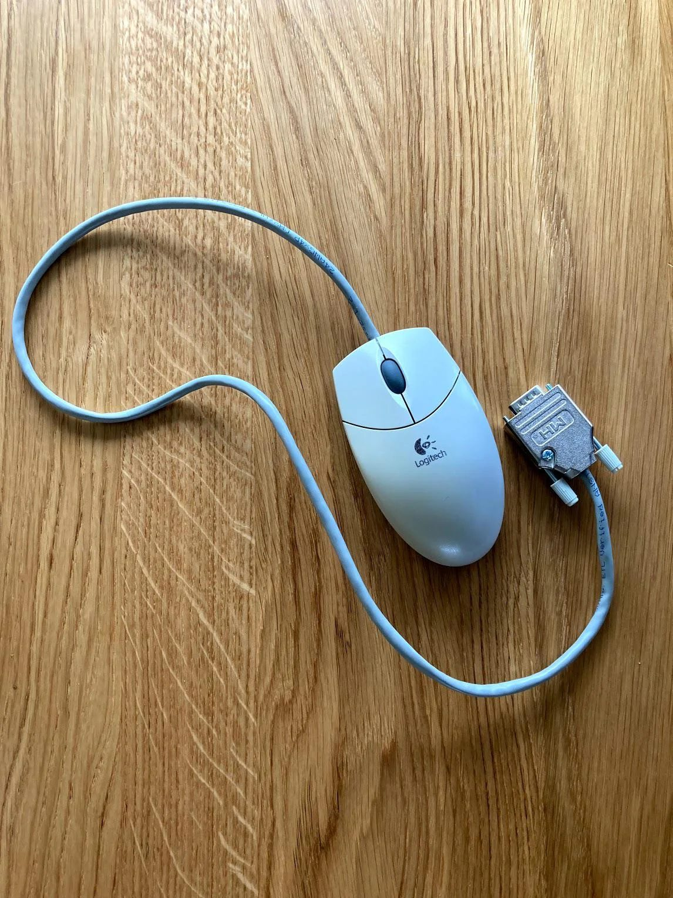

I once acquired a Macintosh Plus in pretty good condition locally, but without a mouse or keyboard. A keyboard showed up some weeks later, but I struggled to find a compatible mouse locally in Switzerland.

From my undergrad days, I somehow recalled that early optical mouse sensors actually had quadrature outputs, simulating the behavior of mechanical mice with a shutter wheel. That should fit!

The project was triggered after digging out the mouse, a DB-9 connector and an old Ethernet cable from an e-waste container at work (shown here already assembled):

Inside, the ADNS-2051 optical mouse chip directly outputs quadrature signals as required by a Macintosh. No conversion using a microcontroller or any other circuitry is needed.

Beautiful, ADNS-2051 actually directly outputs quadrature signals:

So it's enough to solder the X1/X2/Y1/Y2 lines to the chip itself (XA/XB/YA/YB). The two blue wires go to ground, the orange one to +5V and the orange-white one to the button's tactile switch.

Ready to use it with my faithful Plus :)

Aaaand it works!

