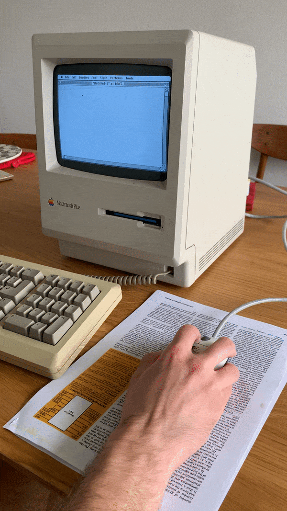

I once acquired a Macintosh Plus in pretty good condition locally, but without a mouse or keyboard. A keyboard showed up some weeks later, but I struggled to find a compatible mouse (the original is the Apple M0100) locally in Switzerland.

## The idea: an optical mouse with quadrature outputs

From my undergrad days, I somehow recalled that early optical mouse sensors actually had quadrature outputs, simulating the behavior of mechanical mice with a shutter wheel. That should fit!

The project was triggered after digging out the mouse, a DB-9 connector and an old Ethernet cable from an e-waste container at work (shown here already assembled):

[{: width="1146" height="1528"}](originals/Untitled.png)

## Wiring the ADNS-2051 sensor to the DB-9 connector

Inside, the ADNS-2051 optical mouse chip directly outputs quadrature signals as required by a Macintosh. No conversion using a microcontroller or any other circuitry is needed.

[{: width="640" height="854" loading="lazy"}](originals/Untitled%201.png)

Beautiful, ADNS-2051 actually directly outputs quadrature signals:

[{: width="1214" height="804" loading="lazy"}](originals/Untitled%202.png)

So it's enough to solder the X1/X2/Y1/Y2 lines to the chip itself (XA/XB/YA/YB). The two blue wires go to ground, the orange one to +5V and the orange-white one to the button's tactile switch.

Ready to use it with my faithful Plus :)

[{: width="1146" height="1528" loading="lazy"}](originals/Untitled%203.png)

## The result

Aaaand it works!

[{: width="600" height="1067" loading="lazy"}](originals/u3pkhcsuehw61.gif)

I also posted this build on Reddit: [DIY 128K/512K/Plus mouse from an e-waste container on r/VintageApple](https://www.reddit.com/r/VintageApple/comments/n2fdhf/diy_128k512kplus_mouse_from_an_ewaste_container/)
