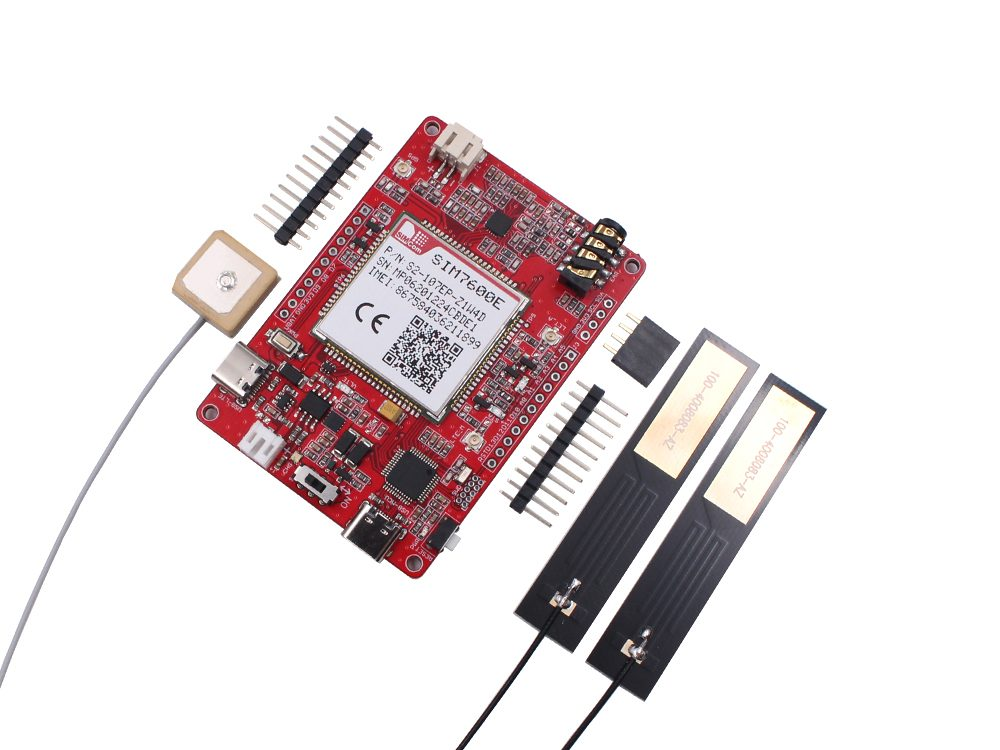
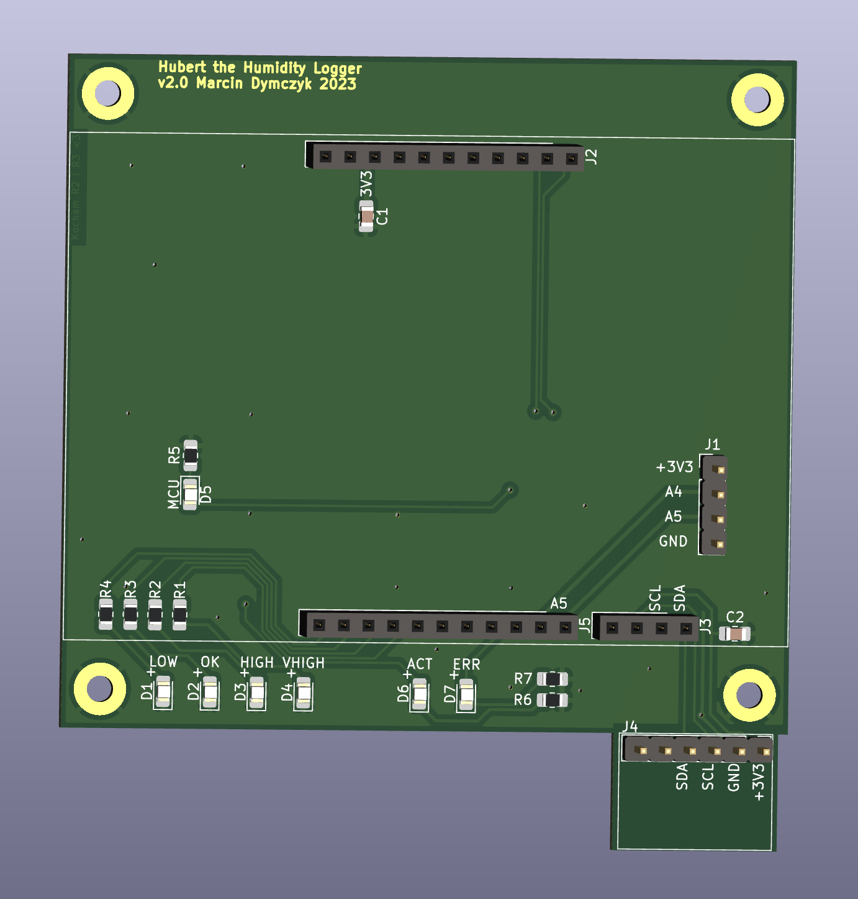
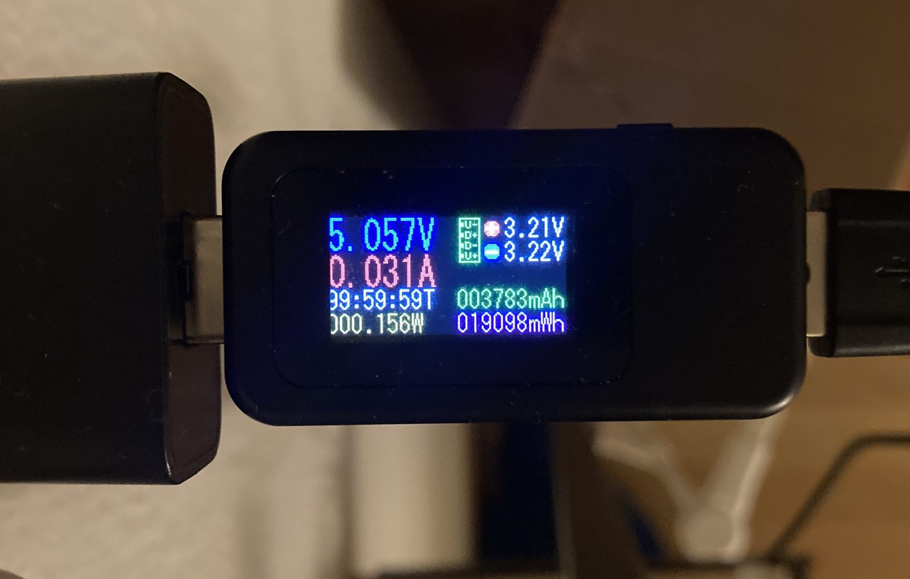
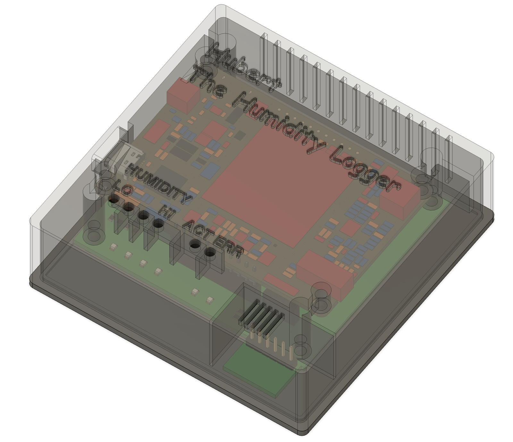
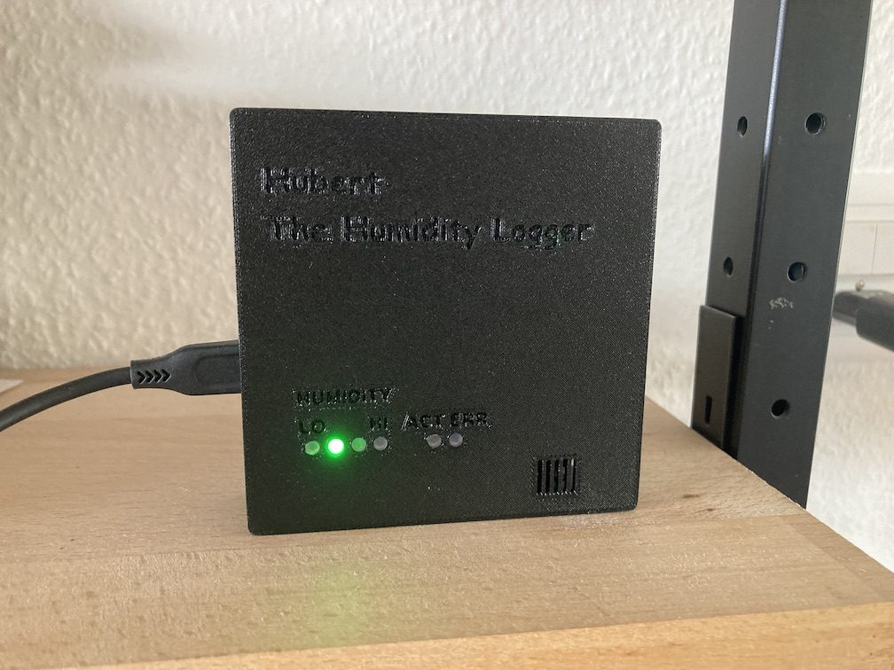

I keep a Saab 900 from 1992 as a fun/project car and I’m generally trying to preserve it well to the extent that is reasonably possible.

One of the factors I want to be careful about is potential rust, and I’d like to keep the humidity in the parking garage somewhat under control. I was using several cheap humidity loggers and making sure to open up the garage whenever it is dry outside to avoid moisture/condensation inside. But it was annoying, because to check the humidity I had to physically be in the garage.

**To improve on this, I needed an IoT-like remote monitoring solution.**

My garage is located a 10-minute walk from home so WiFi/ESP32 solutions were not an option and the solution had to use 4G infrastructure.

To my surprise, I couldn’t find any ready-to-build DIY projects that could serve the purpose or affordable devices I would be willing to pay for. So I decided to build something on my own.

<aside class="callout" markdown="1">
💡 The corresponding GitHub repo ([https://github.com/dymczykm/HubertTheHumidityLogger](https://github.com/dymczykm/HubertTheHumidityLogger)) contains the firmware and hardware files for Hubert.

</aside>

## Hardware

While searching for relevant projects, I came across [this weather station project](https://www.the-diy-life.com/diy-4g-air-quality-and-environment-monitor-record-data-anywhere/) which uses the [Makerfabs Maduino Zero 4G LTE](https://www.makerfabs.com/maduino-zero-4g-lte-sim7600.html). That looks pretty attractive:

- It includes a small ARM microcontroller compatible with Arduino Zero
- It includes a Simcom 7600E modem, which supports 3G/4G/LTE (2G is already getting switched off where I live) and is able to shoot HTTP requests
- It has a convenient pin header to connect a breakout board with peripherals.

[](originals/Maduino-Zero-4G-LTE-SIM7600X-1000x750.jpg)

Maduino Zero 4G LTE board

To actually measure the humidity, I decided to use a simple Bosch BME280 breakout board, available from different sources for a few bucks. There is electricity in my garage, so everything can simply be powered via a USB-C charger connected to Maduino.

The breakout board to host Maduino turned out pretty simple:

[](originals/Screenshot_2023-08-13_at_22.35.40.png)

Simple headers to plug in Maduino, 4 LEDs acting as a bargraph to visualize the humidity level directly, ACT and ERR LEDs to show that something is going on (or not 🙃). Additionally, a 6-pin header to connect the BME280. It is located further away from Maduino and without the ground plane to limit the thermal coupling.

## Firmware

The idea is straightforward - Hubert should wake up at regular intervals (exact time not really critical), take a measurement, submit it to the remote server and go to sleep.

### Taking a measurement

We only need a measurement every few minutes, so the recommended way is to trigger each BME280 measurement manually. Measuring very often causes the BME280 to heat up and bias the readings.

Let’s take a look at the configuration:

```cpp
bme280.setSampling(Adafruit_BME280::MODE_FORCED,
                    Adafruit_BME280::SAMPLING_X1,   // temperature
                    Adafruit_BME280::SAMPLING_X1,   // pressure
                    Adafruit_BME280::SAMPLING_X1,   // humidity
                    Adafruit_BME280::FILTER_OFF);
```

We turn on a forced mode, x1 sampling for all measured values and turn off the filter.

Then, to take a measurement, we call:

```cpp
bme280.takeForcedMeasurement();
delay(200);
```

This triggers a measurement and makes sure the sensor has enough time (200ms) to write the result into its registers before we read out the values:

```cpp
const float temperature = bme280.readTemperature();
const float pressure_hpa = bme280.readPressure() / 100;
const float humidity = bme280.readHumidity();
```

### Submitting to the remote server

The plan here was clear, but as usual with hardware it took a while to get it right. Simcom 7600 offers a built-in HTTP stack that lets you just set all the fields and send a POST/GET request to the server.

A conversation between the MCU and the modem should look like this:

```
AT+HTTPINIT
OK
AT+HTTPPARA="URL","<url>"
OK
AT+HTTPPARA="USERDATA","Authorization: <auth_key>"
OK
AT+HTTPDATA=<data_length>,1000
DOWNLOAD
<data>
OK
AT+HTTPACTION=1
+HTTPACTION: 1,200,2
```

It did look like this, but the USERDATA never ended up in the header, so my POST request was never authorized by the server. I spent several evenings trying to figure this out. Eventually, out of ideas (and somewhat convinced something was wrong with the modem), I contacted Simcom.

<aside class="callout" markdown="1">
⚠️ It turned out that the firmware of my modem (`LE11B14SIM7600M22`) has a bug. Simcom provided a new firmware `LE11B14V01SIM7600M22_221022` which completely resolved the issue.

</aside>

For more details related to the modem and data POSTing, refer to `influxdb.h` and `sim7600.h` files.

### Going to sleep

For many reasons (from the planet to the electricity bill) I’ve invested extra effort to make sure Hubert is not eating too much energy. There are two ways to do that:

- Use `ArduinoLowPower` library to put the CPU into deep sleep during the wait intervals.
- Use an AT command to enable the sleep mode of the modem (`AT+CSCLK=1`) and then pull the `DTR` pin high whenever the modem should sleep (it still maintains the 4G connection though).

This turned out pretty efficient, with 30mA used during sleep and around 200mA while submitting over 4G. On average, the device uses around 0.17W, which I think is acceptable.

[](originals/IMG_1501.jpeg)

0.15W used when idle, as measured on the USB power supply.

## GUI and UX

For visualizing the data, I followed a recommendation from a colleague at work and used InfluxDB and Grafana. Everything could be set up on my antique Raspberry Pi 1 Model B+.

A few details:

- Both Grafana and InfluxDB are set up locally on the Raspberry Pi.
- The Raspberry Pi has a watchdog that resets it if it stops responding.
- My router forwards the port to the Raspberry Pi.
- I’m using a dynamic DNS to avoid problems if my public IP changes (which happens every now and then).

In practice, the setup is super stable and I access the Grafana dashboard from any device on the home network.

The onboard indicators work as follows:

- When initializing:
    - All LEDs light up as a test.
    - If a problem occurs, ERR (red) starts to blink fast.
- When posting:
    - Either ACT (green) or ERR (red) lights up for several seconds, depending on whether the data was successfully submitted or not.
- When idle:
    - Either ACT (green) or ERR (red) blinks for a fraction of a second every 2 seconds indicating whether the last POST action was successful. Given that the device might POST every few minutes, that’s a useful feature to immediately know whether everything worked as expected the last time.

## Case

To finalize the project, I designed a 3D-printable case for Hubert. It lets me screw down the breakout board using standoffs, uses light pipes to show the status to the outside world and contains a semi-closed compartment (isolated from the MCU/modem) for the BME280 sensor to reduce heat transfer as much as possible.

[](originals/hubert_fusion360.png)

In reality, the case turned out pretty nice. Maybe the text is not super crisp, but I still like it a lot!

[](originals/IMG_1504.jpeg)

Hubert during early testing at home. Apparently, the humidity is within the green range!
