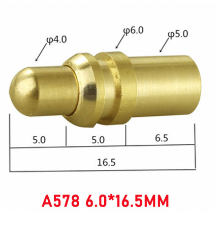
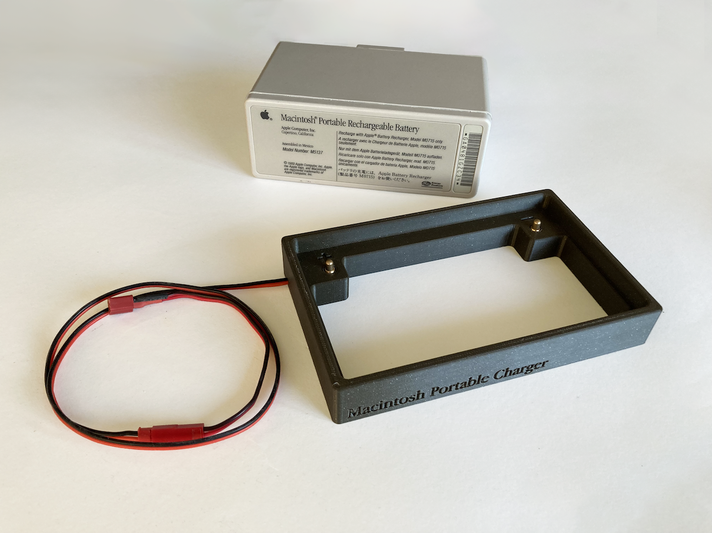
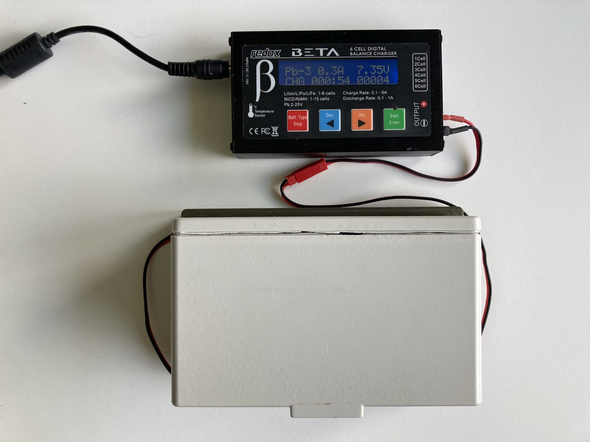

## Why is that useful?

I happen to own three Macintosh Portables. Those computers use a 3-cell lead battery, which consists of Enersys Cyclon cells. The batteries cannot be kept installed int the computer, as they will get completely drained within 2-3 months and get irreversibly damaged once stored empty.

So I kept my stash of batteries separately, but then what’s the best way to charge once per 6-12 months? I’ve used a “smart” RC battery charger, but **it was a real pain to reliably connect wires to the battery, which has recessed contacts.**

Apple has actually offered an external charger for Portable:

Source: [https://www.worthpoint.com/worthopedia/apple-brand-macintosh-portable-1801509065](https://www.worthpoint.com/worthopedia/apple-brand-macintosh-portable-1801509065)

So the plan was to create something similar using a 3D printer and off-the-shelf components.

## The design

The idea was fairly simple, let’s a 3d printable tray that holds the battery and makes reliable contact with the battery contacts.

The original charger used spring-loaded contacts (ie. really large diameter pogo pins). The choice at usual suppliers was limited and I found good candidates on Aliexpress:

Link: [https://www.aliexpress.com/item/1005003405928702.html?spm=a2g0o.order_detail.order_detail_item.8.6e1ef19chS1Kfr](https://www.aliexpress.com/item/1005003405928702.html?spm=a2g0o.order_detail.order_detail_item.8.6e1ef19chS1Kfr) (make sure to pick A578)

The type A578 offers large diameter to make sure relatively high currents can flow without too much resistance, on the other hand enough travel (5mm) of the pin to have enough tolerance when placing the battery.

Now about the tray. I found a 3D printable model of a Portable battery on Thingverse, which was a very good start:

[Macintosh Portable Battery Enclosure (M5137) by StephenLulz](https://www.thingiverse.com/thing:5185715)

Then I designed a tray resembling the original one in Fusion 360 around the battery model and including the A578 pins:

And that’s it - print it, press the pins into the printed model, solder some wires and ready. The brown color of the tray is not exactly my choice - it’s recycled filament to limit the environmental impact of 3D printing 🌍

<aside class="callout" markdown="1">
💾 Here’s the STL file to print the battery tray:

[MacPortableCharger v37.stl](originals/MacPortableCharger_v37.stl)

</aside>

## Usage

I used the tray together with an RC battery charger set to charge a 3-cell lead battery. I crimped a typical JST SYP battery connector to make sure the tray is safe, without a possibility to short the battery or to invert the polarity.

## Appendix: Macintosh Portable battery cell info

By the way, the original type of cells is still available, I purchased them from the TME electronic distributor and they worked great (and were exactly like the originals):

[0800-0004 ENERSYS - Re-battery: acid-lead · 2V; 5Ah; Size: X; AGM; Ø44x73mm; -85÷85°C; CYCLON-X · TME - Electronic components](https://www.tme.eu/en/details/cyclon-x/acid-cells/enersys/0800-0004/)
