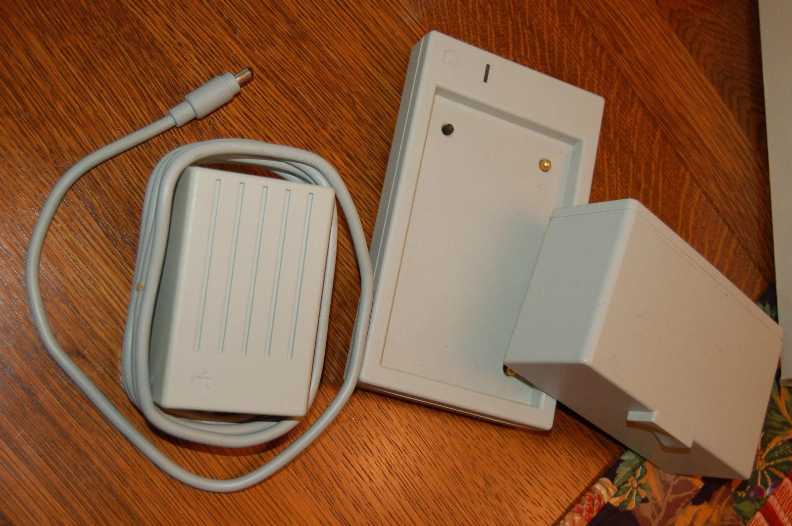
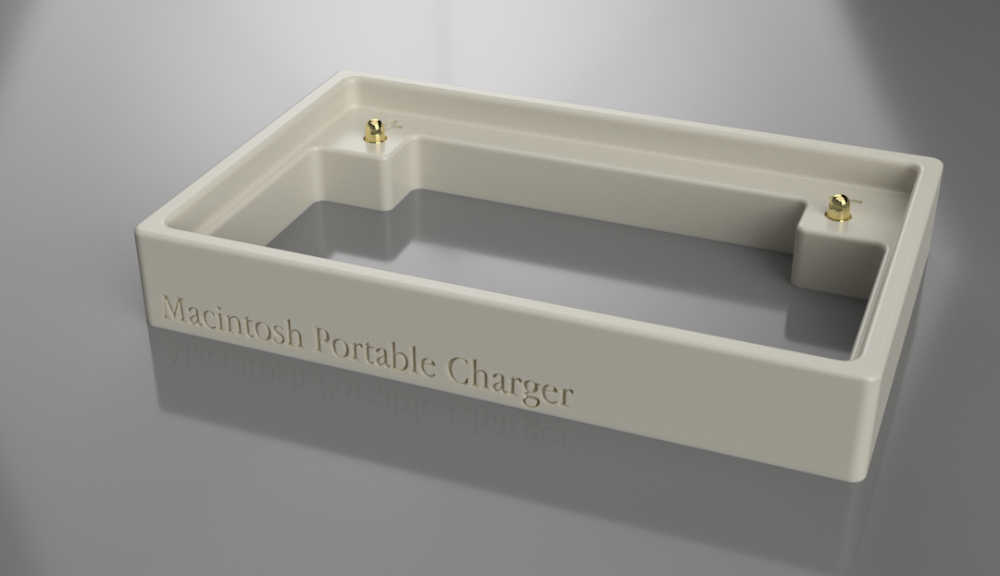

## Why charge Macintosh Portable batteries outside the computer?

I happen to own three Macintosh Portables. Those computers use a 3-cell lead-acid battery, which consists of Enersys Cyclon cells. The batteries cannot be kept installed in the computer, as they get completely drained within 2-3 months and are irreversibly damaged when stored empty.

So I kept my stash of batteries separately, but then what’s the best way to charge them every 6-12 months? I’ve used a “smart” RC battery charger, but **it was a real pain to reliably connect wires to the battery, which has recessed contacts.**

Apple actually offered an external charger for the Portable:

[{: width="1600" height="1063"}](originals/1_fb695a1003c1489d23b6e6f74204369b.jpg)

Source: [https://www.worthpoint.com/worthopedia/apple-brand-macintosh-portable-1801509065](https://www.worthpoint.com/worthopedia/apple-brand-macintosh-portable-1801509065)

So the plan was to create something similar using a 3D printer and off-the-shelf components.

## The design: a 3D-printed tray with pogo pins

The idea was fairly simple: make a 3D-printable tray that holds the battery and makes reliable contact with the battery contacts.

The original charger used spring-loaded contacts (i.e. really large-diameter pogo pins). The choice at the usual suppliers was limited, but I found good candidates on Aliexpress:

[{: width="433" height="445" loading="lazy"}](originals/Untitled.png)

Link: [https://www.aliexpress.com/item/1005003405928702.html](https://www.aliexpress.com/item/1005003405928702.html) (make sure to pick A578)

The A578 type has a large diameter, so relatively high currents can flow without too much resistance, and enough travel (5mm) to tolerate some play when placing the battery.

Now about the tray. I found a 3D printable model of a Portable battery on Thingiverse, which was a very good start:

[Macintosh Portable Battery Enclosure (M5137) by StephenLulz](https://www.thingiverse.com/thing:5185715)

Then I designed a tray resembling the original one in Fusion 360 around the battery model and including the A578 pins:

[{: width="1080" height="623" loading="lazy"}](originals/MacPortableCharger_v38_small.png)

And that’s it - print it, press the pins into the printed model, solder some wires and you’re done. The brown color of the tray is not exactly my choice - it’s recycled filament to limit the environmental impact of 3D printing 🌍

[{: width="1210" height="907" loading="lazy"}](originals/IMG_1478_small.png)

<aside class="callout" markdown="1">
💾 Here’s the STL file to print the battery tray:

[MacPortableCharger v37.stl](originals/MacPortableCharger_v37.stl)

</aside>

## Charging with an RC battery charger

I used the tray together with an RC battery charger set to charge a 3-cell lead battery. I crimped a typical JST SYP battery connector to make sure the tray is safe, without a possibility to short the battery or to invert the polarity.

[{: width="1600" height="1200" loading="lazy"}](originals/Untitled.jpg)

## Charging voltage and current for the Macintosh Portable battery

The Portable battery is three Cyclon cells in series, so the right charger settings follow directly from the EnerSys Cyclon application manual. Here are its values, converted to the 3-cell battery (all at 25°C):

| | Per cell | 3-cell Portable battery |
| --- | --- | --- |
| Fast (cyclic) charge, constant voltage | 2.45-2.50V | 7.35-7.50V |
| Float (standby) charge, constant voltage | 2.25-2.30V | 6.75-6.90V |
| Resting voltage, fully charged | about 2.14V | about 6.4V |
| Resting voltage at which a stored battery should be recharged | 2.00V | 6.0V |
| Resting voltage of an empty cell, don’t let it drop below this | 1.93V | 5.8V |

A few more notes from the manual:

- **Which voltage?** The fast-charge voltage is the one for a periodic recharge where the battery is taken off the charger afterwards. The float voltage is for a battery that stays connected permanently. On an RC charger, that means the Pb (lead-acid) program set to 3 cells. In the photo above the charger shows 7.35V, which is 2.45V per cell.
- **Which current?** With constant-voltage charging, the manual says no current limit is necessary. For a full charge in about 16 hours, the charger should be able to deliver at least 0.4C, which is 2A for the 5Ah cells. Less current works too, it just takes longer: about 26 hours at 0.5A.
- **Temperature:** lower the charging voltage by about 3mV per cell (9mV for the battery) for every °C above 25°C, and raise it by the same amount when it’s colder.
- **Storage:** check the resting voltage about every six months and recharge when it approaches 6.0V. A cell left below 1.93V can be damaged permanently.

Sources: the [EnerSys Cyclon application manual, fifth edition (2004)](https://forums.parallax.com/uploads/attachments/41825/44643.pdf) and the older [Hawker Cyclon application manual (2000)](https://www.farnell.com/datasheets/69062.pdf). The older edition gives a slightly higher float range of 2.27-2.35V per cell (6.81-7.05V).

## Replacement cells for the Macintosh Portable battery (EnerSys Cyclon)

By the way, the original type of cells is still available, I purchased them from the TME electronics distributor and they worked great (and were exactly like the originals):

[EnerSys Cyclon X 0800-0004 (2V, 5Ah) at TME](https://www.tme.eu/en/details/cyclon-x/acid-cells/enersys/0800-0004/)
