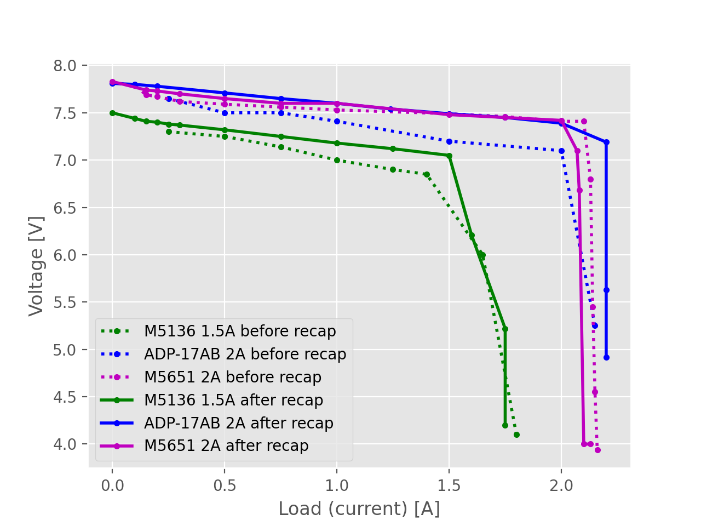

Online, you can find a lot of discussions related to what power brick to use with Macintosh Portable (the original is M5136 7.5V 1.5A), if it has to be exactly 1.5A or can be more and if it’s worth recapping the power supplies.

I decided to at least somehow help in those discussions with verifying two hypotheses on the bench:

- Is it worth recapping?
- What is the voltage-current curve of the Portable power supply and to what extent does it differ from an Apple 2A power supply. This would permit others to potentially measure and select the power supply with the closest characteristics.

So I took 3 PSUs on my bench:

- M5136 7.5V 1.5A (Macintosh Portable)
- M5651 7.5V 2A (I usually saw it with PowerBook 100, it’s 15W nominal, but the Apple Technical Article claims it’s 19W?)
- ADP-17AB 7.5V 2A (PowerBook 150)

By the way, here’s the archived Apple Technical Article about the PSU part numbers:

[http://web.archive.org/web/20100423034550/http://support.apple.com/kb/TA32393](http://web.archive.org/web/20100423034550/http://support.apple.com/kb/TA32393)

Regarding the claims that using a high wattage adapter on Portable might be dangerous, Apple in this TA seems to be suggesting something similar for PB100 and PB150:

## Is it worth recapping?

Yes, definitely! 

The old capacitors in those PSUs tend to lose rated capacitance and leak. The current curves in my case were slightly affected by the capacitors, I’m pretty sure that dynamic characteristics (eg. impulse response) would make it even more apparent.

Leakage is another problem - the capacitor goo really eats out the soldermask and copper traces, making the PSUs simply non functional. Out of the three, ADP-17AB had pretty apparent traces of capacitor leakage:

The soldermask was eaten away already and the copper was affected.

Fortunately, the copper traces cleaned out nicely - after recapping they were covered with a PCB lacquer.

## The voltage-current curves or what is the difference between the adapters?

I decided to spin an experiment and load the PSUs with various combinations of power resistor to record their voltage-current traces. 

Here’s the result:

Conclusions?

- The output voltage of M5136 (Mac Portable) strongly drops at 1.5A, but even at 1.0A it’s only ~7.25V. It’s also clearly visible how the recap helped, before at 1.0A it was even lower at 7.0V!
- M5651 and ADP-17AB behave pretty much the same and could be considered interchangeable.
- Recapping of ADP-17AB made a big difference under load starting at 1.0A. At 1.5A, it brought about 400mV difference and 2.0A even slightly more.
