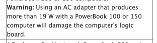
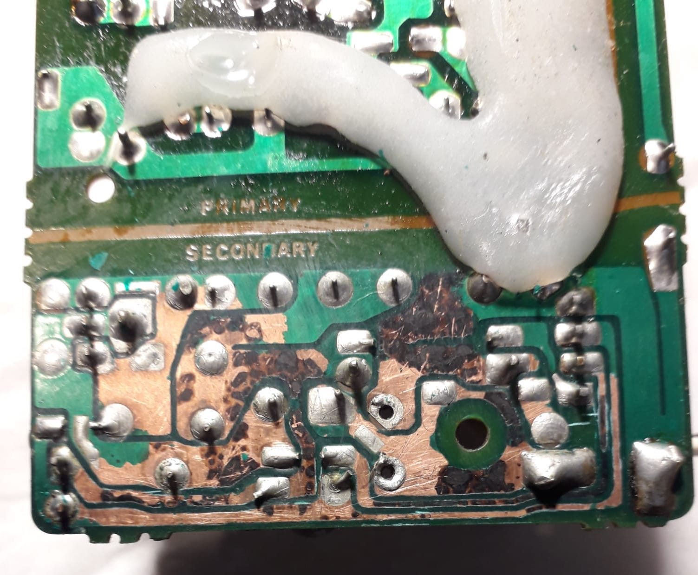
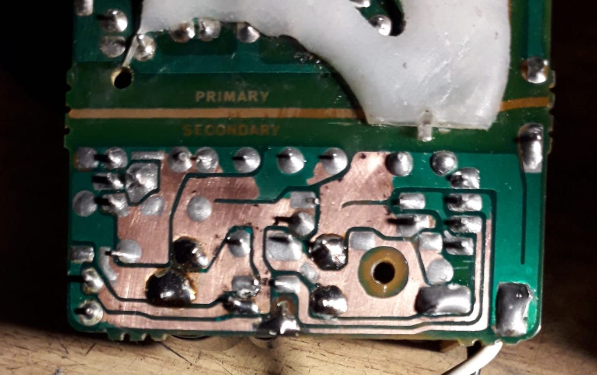

Online, you can find a lot of discussions related to what power brick to use with the Macintosh Portable (the original is M5136 7.5V 1.5A), whether it has to be exactly 1.5A or can be more, and whether it’s worth recapping the power supplies.

I decided to contribute to those discussions by checking two questions on the bench:

- Is it worth recapping?
- What is the voltage-current curve of the Portable power supply and to what extent does it differ from an Apple 2A power supply? This would allow others to potentially measure and select the power supply with the closest characteristics.

So I put three PSUs on my bench:

- M5136 7.5V 1.5A (Macintosh Portable)
- M5651 7.5V 2A (I usually saw it with PowerBook 100, it’s 15W nominal, but the Apple Technical Article claims it’s 19W?)
- ADP-17AB 7.5V 2A (PowerBook 150)

By the way, here’s the archived Apple Technical Article about the PSU part numbers:

[http://web.archive.org/web/20100423034550/http://support.apple.com/kb/TA32393](http://web.archive.org/web/20100423034550/http://support.apple.com/kb/TA32393)

Regarding the claims that using a higher-wattage adapter on the Portable might be dangerous, Apple in this TA seems to be suggesting something similar for PB100 and PB150:

[{: width="312" height="86"}](originals/Untitled.png)

## Is it worth recapping the power adapters?

Yes, definitely!

The old capacitors in those PSUs tend to lose rated capacitance and leak. The current curves in my case were slightly affected by the capacitors, and I’m pretty sure that dynamic characteristics (e.g. impulse response) would make it even more apparent.

Leakage is another problem - the capacitor goo really eats out the soldermask and copper traces, making the PSUs simply non-functional. Out of the three, ADP-17AB had pretty apparent traces of capacitor leakage:

[{: width="1503" height="1239" loading="lazy"}](originals/WhatsApp_Image_2022-07-26_at_09.52.21_copy.jpeg)

The soldermask was eaten away already and the copper was affected.

[{: width="1365" height="858" loading="lazy"}](originals/WhatsApp_Image_2022-07-28_at_21.40.30.jpeg)

Fortunately, the copper traces cleaned up nicely - after recapping they were covered with a PCB lacquer.

## Voltage-current curves: M5136 vs. M5651 vs. ADP-17AB

I set up an experiment, loading the PSUs with various combinations of power resistors to record their voltage-current curves.

Here’s the result:

[{: width="1280" height="960" loading="lazy"}](originals/powerbook_adapters.png)

Conclusions?

- The output voltage of M5136 (Mac Portable) strongly drops at 1.5A, but even at 1.0A it’s only ~7.25V. It’s also clearly visible how the recap helped: before it, the voltage at 1.0A was even lower, at 7.0V!
- M5651 and ADP-17AB behave pretty much the same and could be considered interchangeable.
- Recapping of ADP-17AB made a big difference under load starting at 1.0A. At 1.5A, it made about a 400mV difference, and at 2.0A even slightly more.

## Can you use a 2A adapter with the Macintosh Portable?

It is hard to say from these measurements alone. What I can say for sure is that the 1.5A and 2A adapters are not equivalent: there is a real, measurable difference, clearly visible in the plot. The 2A adapters put out about 0.3-0.4V more than the M5136 across the whole load range (7.8V instead of 7.5V with no load, and still about 0.4V more at 1.5A), and they hold their voltage up to 2.0A, while the M5136 collapses right after 1.5A.
