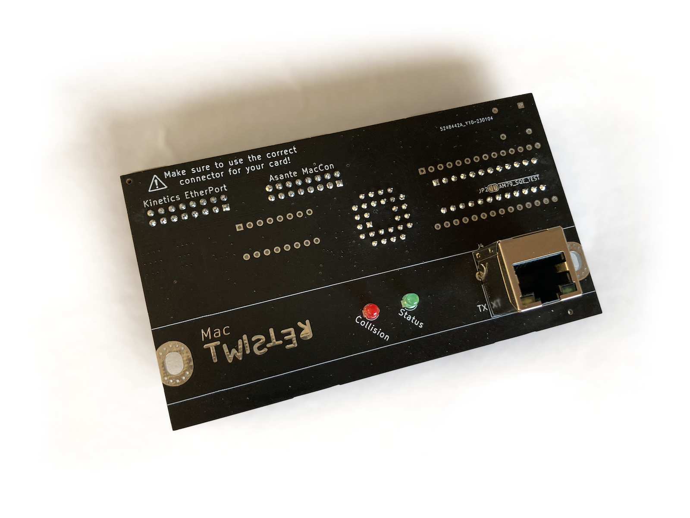
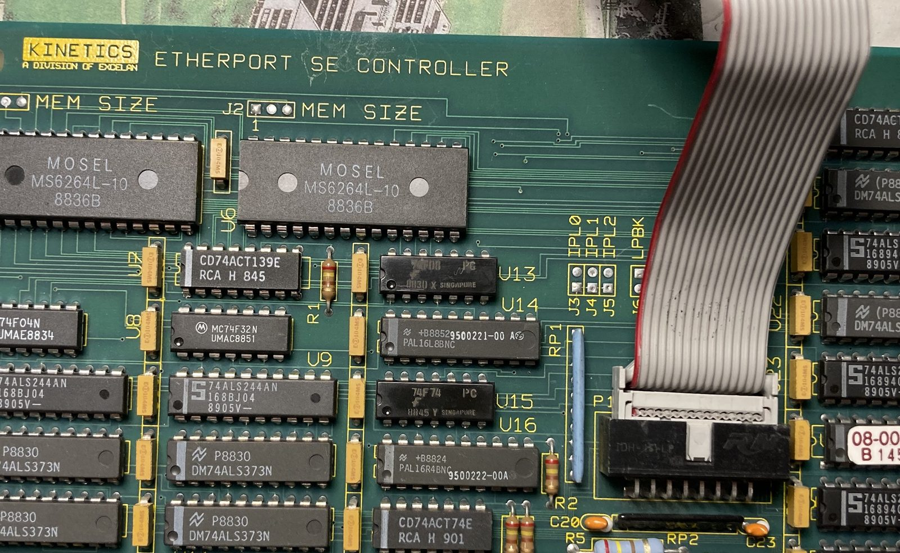
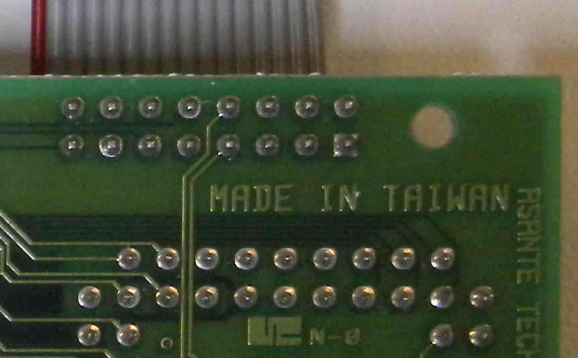
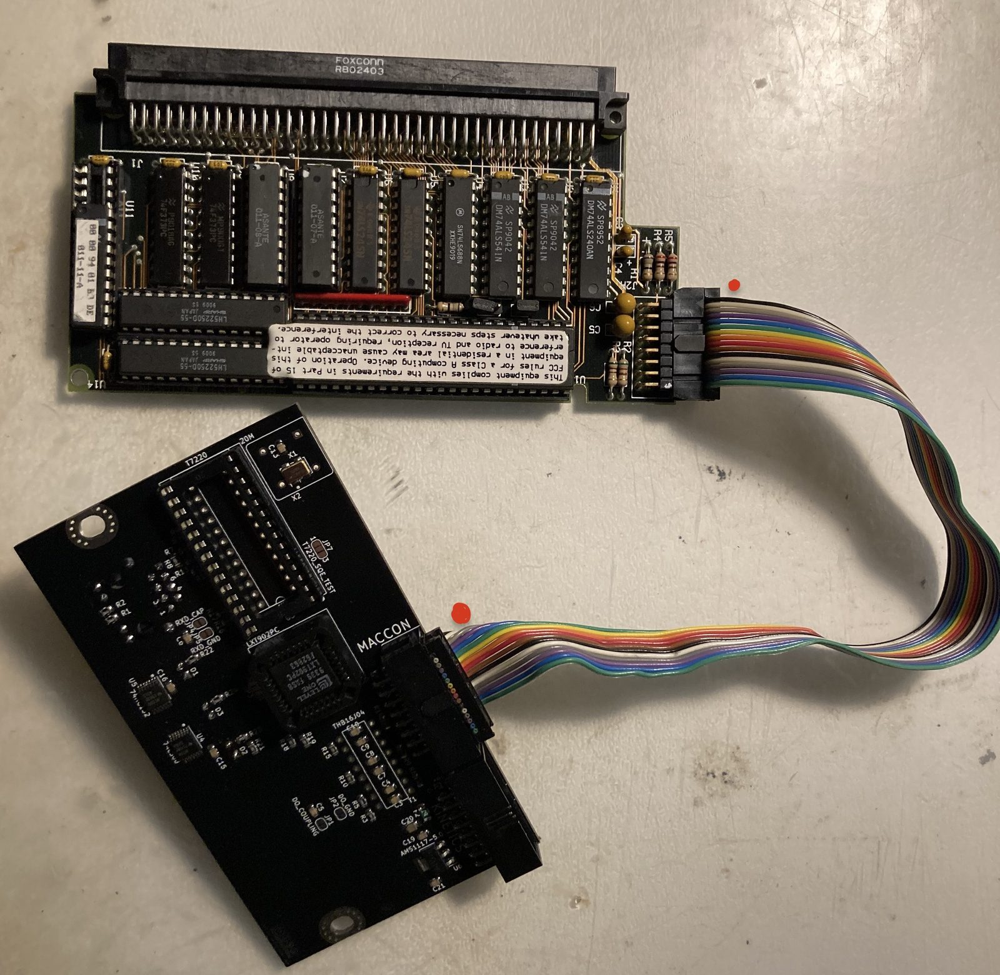
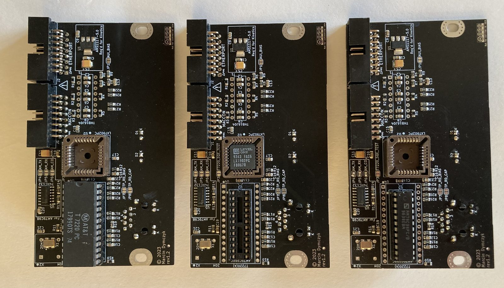
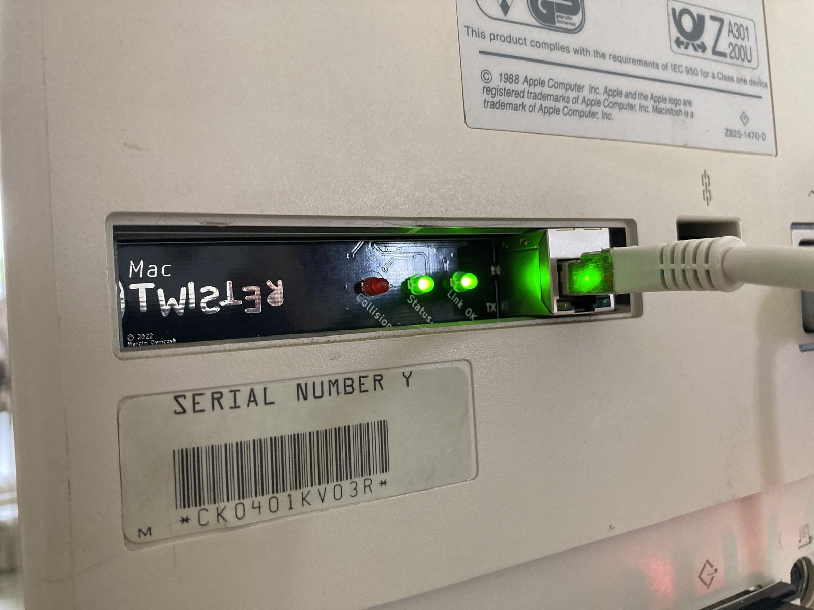
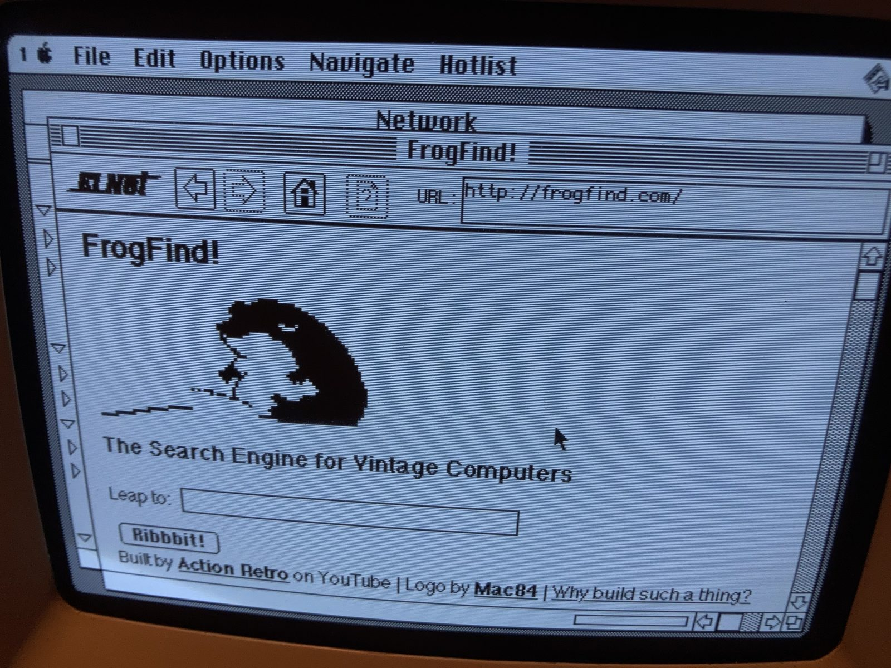
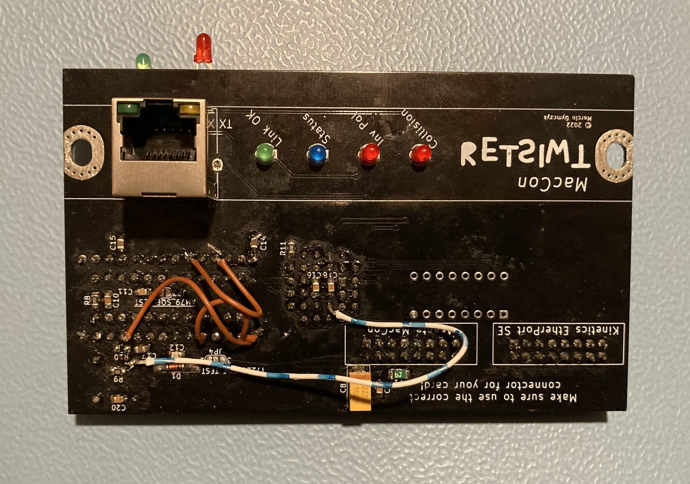

[{: width="1600" height="1200"}](originals/IMG_1487.png)

The MacTwister breakout board provides a standard RJ45 port for Macintosh SE and Macintosh SE/30 computers equipped with common Asante MacCon, Kinetics/Shiva Etherport and Dayna DaynaPort E/SI cards.

The first motivation is that many of those cards got separated from their breakout boards over the course of more than 30 years, making them virtually useless. At the same time, network card prices keep going up, so reproducing the connector board starts to make economic sense. I myself came across a MacCon for SE which I really wanted to bring back to life.

The second motivation is that most of the connector cards only offer AUI and BNC (10BASE2) connectors, requiring an external box (such as CentreCOM AT-210T) that sticks out and doesn’t look too cool. Maybe I’m unlucky, but none of the cards I own actually came with a twisted pair interface.

Goals of the design:

- Support the most common cards for SE and SE/30: MacCon, Etherport and Dayna.
- Support a number of transceiver chips to avoid being locked into a single no-longer-produced model, preferably without component changes.
- Use modern components (e.g. an RJ45 jack with magnetics) to avoid sourcing anything exotic apart from transceivers.

## Questions & answers

### What’s the deal with two 16-pin connectors?

Kinetics/Shiva Etherport and MacCon cards have different pinouts of the 16-pin cable to the connector card.

**Please be extra careful about using the right connector for your card.
Please be extra careful about correctly orienting the plug in the socket (mind the pin 1 markings). Note that MacCon cards do not use the common pin 1 convention of the IDC connectors.**

[{: width="1600" height="984" loading="lazy"}](originals/IMG_5749.jpeg)

Kinetics Etherport SE. Note that the pin 1 marking (P1) matches the red conductor on the IDC tape.

[{: width="578" height="358" loading="lazy"}](originals/maccon.png)

Asante MacCon. The pin 1 on the PCB (square pad) does not match the pin 1 on the IDC tape.

[{: width="1600" height="1560" loading="lazy"}](originals/IMG_8356.jpeg)

MacTwister connected to an early revision of MacCon. Please note the pin 1 markings in the picture. On MacCon, the PCB suggests pin 1 is actually on the other side; ignore it.

Both 16-pin connectors can be used without any changes to the board.

### What’s the deal with three different sockets for transceiver ICs?

This board depends on no-longer-available AUI to twisted pair converters. Those transceivers have been out of production for decades, so this design incorporates three different chips to let you pick a chip that actually shows up on the market: LXT902PC, AM79C89 or T7220 / T7220A.

[{: width="1600" height="915" loading="lazy"}](originals/IMG_1484.jpeg)

The same MacTwister design working with three different transceivers: from left to right T7220, LXT902PC and AM79C89.

All three ICs are tested and work fine with a modern Netgear R7000 router.

Swapping chips requires no changes apart from bridging JP4, JP5 and JP6 jumpers to control the status LEDs.

### What was it tested with?

The card was tested on the SE (MacCon and Etherport cards) and SE/30 (MacCon).

[{: width="1600" height="1200" loading="lazy"}](originals/IMG_8376.jpeg)

MacTwister card fitting and happily exchanging data on Macintosh SE.

[{: width="1600" height="1200" loading="lazy"}](originals/IMG_8367.jpeg)

Macintosh SE surfing the modern web.

### What was the journey to design it?

The circuit is fairly simple, but it took a few iterations to get it right. The transceivers are niche and their datasheets had a few ambiguities or even mistakes.

It turned out that T7220A is not just a revision of T7220 ;)

It also turned out that there’s no single common standard for RJ45 connectors and their pinouts, including the polarity of LEDs (sigh).

[{: width="1600" height="1124" loading="lazy"}](originals/IMG_8361.jpeg)

The first development revision required a bit of cable spaghetti to get the RJ45 connector signals right.
