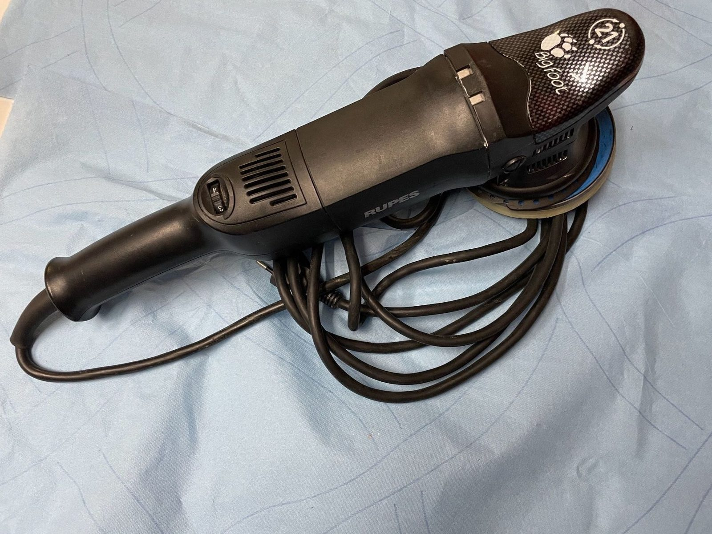
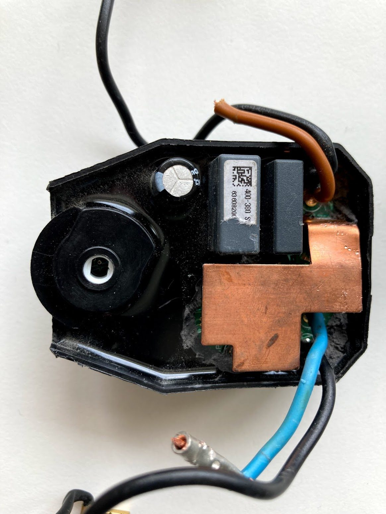
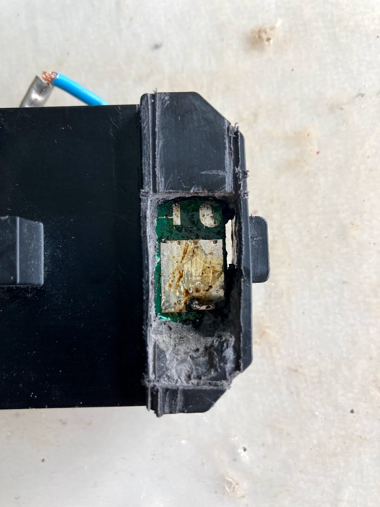
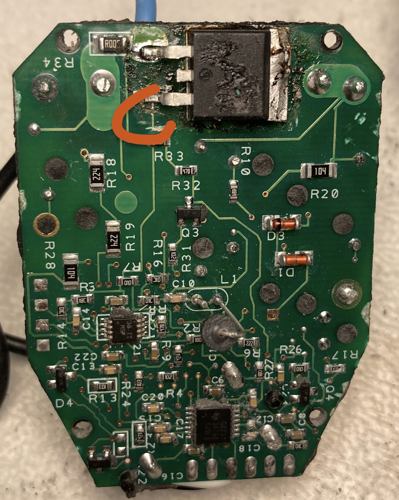
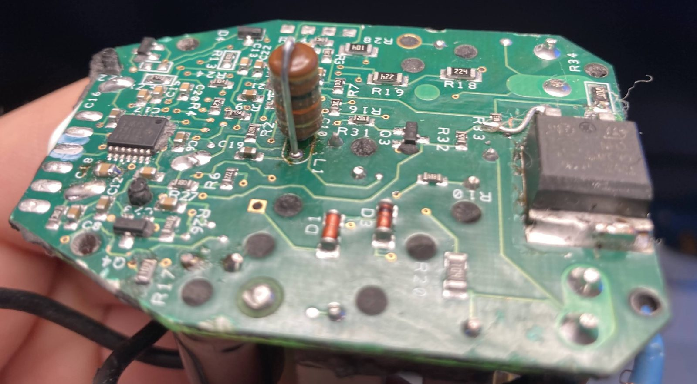

To give my Saab 900 a bit more shine, I decided to get a paint polishing machine and came across a non-functional Rupes Big Foot LHR21.

## Checking and correcting the placement of the motor brushes

The first look inside revealed that carbon brushes were misplaced, stuck and definitely didn’t make any contact with the rotor (you can just measure the resistance across the rotor; it should be in the range of a few ohms, maybe tens of ohms). I reassembled them correctly, but the machine was still dead. Hm, probably the brushes were wrongly mounted in an unsuccessful repair attempt, but not the real culprit.

So what now? Let’s check the motor.

## Checking the motor

The first candidate to test was the motor / rotor. That’s easy to test - it’s enough to apply 20-30VDC from a lab power supply to the brushes to confirm the motor starts turning. It did turn, perfect, so the motor is fine.

## Fixing the Electronic Speed Controller

So we were left with the last candidate - the ESC. I’ve tried searching online for any leads from people who had tried to repair it, or at least disassemble it. Nothing, it seems nobody has really tried to dig into the circuit. I was not really eager to spend $130 for a new ESC so I decided to give repair a shot.

This is what the module looks like:

The board is covered in some half-elastic epoxy/polyurethane goo. I had a strong suspicion that you can find the power switching element under the slightly elevated area in the back. So I took a small saw, cut the plastic and then, using a screwdriver (bad idea) and a hot-air gun, dug down until I reached the electronics.

Et voilà:

Here it is, the T2535-800G 25A 800V D2PAK triac. On the right you can already see a new one soldered in.

But… it still didn’t work. Having nothing to lose, I decided to dig out the entire PCB.

Now it’s clear - when trying to remove the epoxy substance around the triac to replace it, I accidentally cut the trace that controls the triac.

Additionally, when removing the PCB and digging out all the gunk, we lost the “sensor” used to sense the RPM of the motor shaft. Too bad. Let’s get it fixed.

Sorry for the ugly, thick wire next to the triac - this was only a test made out of the first solderable conductive part that I had on the bench 😅

For the sensor, its remains looked very much like an inductor and it *seemed* like it was 10mH based on the color stripes. So I ordered the following part from Digikey: Bourns 8250-103K-RC, a 10mH, 50mA, 93.1Ω through-hole fixed inductor.

You can see the inductor soldered in (the vertical brown cylinder with stripes) in the photo above.

<aside class="callout" markdown="1">
💡 **Why an inductor?**
In Rupes polishers of this series, there’s a permanent magnet mounted on the shaft of the motor. A rotating magnet next to the coil induces some current in the windings of the inductor, which in turn can be measured by the speed control system.

</aside>

Then I put together the module (using electronics-grade silicone to make everything vibration resistant) and the entire machine. And it works! ☺️

<aside class="callout" markdown="1">
💡 **TL;DR**
1. Rupes LHR ESCs are repairable without too much hassle.
2. Based on the one sample I’ve fixed, the triac can go bad leaving the machine completely dead.
3. You should reach the triac by cutting the plastic with a saw and then digging out the PCB coating. **Be extra careful and use a soft tool**, otherwise you risk cutting the PCB traces like I did.

</aside>

I hope this helps keep some more machines working and saves the planet a few unnecessary new ESCs.
