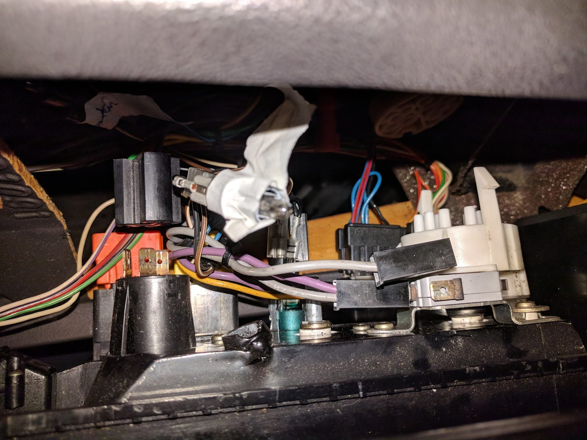
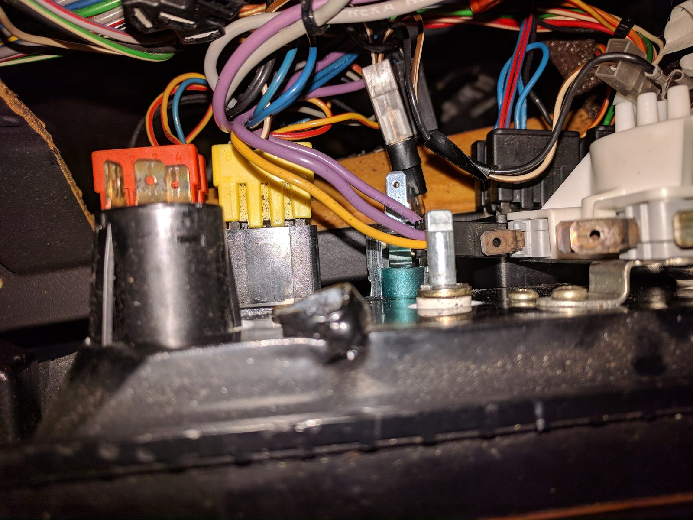

A classic problem for Saab 900 Classic (C900) DIYers after removing the dashboard panel is how to reconnect the wiring of the air distribution switch. This is the knob in the dashboard that sends air to the windscreen, the face vents or the floor. The back of the switch has simple spade connectors, and nothing stops you from plugging a wire onto the wrong terminal, so write down the colours before you pull anything off.

## Wire colours, top to bottom

Here’s how it’s wired on my ‘92 convertible, looking at the back of the switch, top to bottom:

1. Gray
2. Gray-Violet
3. Empty
4. Empty
5. Violet
6. Violet-Yellow

I checked this on my own car only. The 900 Classic was built for model years 1979 to 1993 (the convertible until 1994), and the switch should be the same on the hatchback, sedan and convertible. Owners of 1987 and 1989 cars on the Saabnet forum report the same set of colours, sometimes in a slightly different order, so compare with your car before relying on it.

View from the top, with the top gray connector disconnected:

[{: width="1600" height="1200"}](originals/IMG_20180620_192652.jpeg)

View after disconnecting the top two cables:

[{: width="1600" height="1200" loading="lazy"}](originals/IMG_20180620_192745.jpeg)

## What the switch does

The flaps that direct the air are moved by vacuum servos, not cables. According to the Saab service manual, they are “controlled by microswitches actuated by the air distribution control knob”. The switch also controls the fan: the fan switch itself has no off position, so turning the air distribution knob to “0” is what cuts power to the fan. If the fan doesn’t run, or the air comes out of the wrong vents after you put the dashboard back together, check the wiring on this switch first.

## Why I had the panel out

I had no symptoms. I had to take the panel out to fix the dashboard mounting: the long sleeves that the long mounting screws go through had broken, so I glued them back together.

## Removing the panel

1. Remove the head unit (radio).
2. Undo the four long screws from beneath the dashboard. Each screw is a different length (176, 189, 205 and 210 mm according to the workshop manual) and carries an identification mark, so keep track of which hole each one came from.
3. Carefully pull the panel out towards you.
4. Write down the wire colours on the air distribution switch and disconnect them.

Refitting is the reverse. Reconnect the switch using the list above before you push the panel back in.
