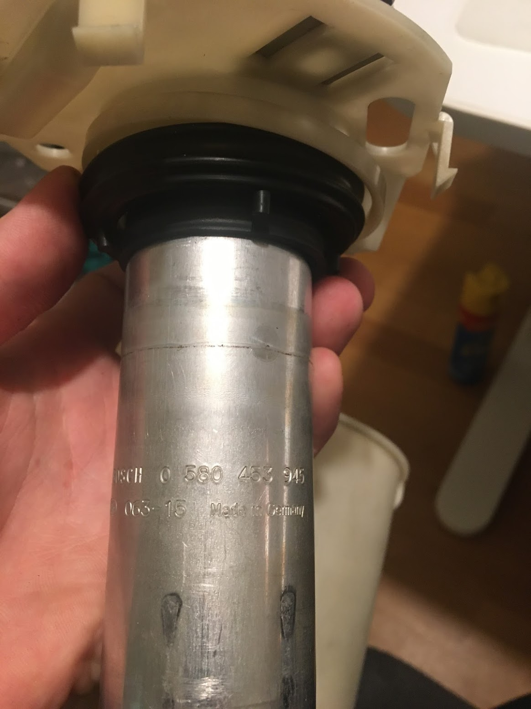

The in-tank fuel pump is a fairly common fault on the Saab 900 Classic (C900) Turbo. A worn pump either gets stuck, or it can’t keep up with the fuel flow the engine needs under boost.

## The OEM pump

In my experience, many, if not all, OEM Saab 900 Classic fuel pumps from 16V ‘90+ Turbos had a Bosch pump cartridge, like this:

The Bosch number is: 0 580 453 945 (0580453945).

The pump is specific to the Turbo: the OEM pump assembly even has a “Turbo” sticker on top. Check that a part listed simply as “Saab 900” is actually meant for the Turbo.

## Finding the right replacement

It’s not easy to source the right pump anymore. The usual Saab parts suppliers sell generic Bosch pumps with varying inlet and outlet diameters and no guarantee of the fuel flow. It is possible to retrofit a Walbro fuel pump cartridge with minor adaptations, but I found a lot of confusing information on the required diameters and the fuel flow.

After a long search for the correct fit, I found that the “BOSCH ELECTRIC FUEL PUMP 69576” item offered by a few sellers on eBay at $40-45 is the exact same Bosch cartridge with the correct Bosch number. The 69576 PN seems to be a US catalogue number: the one I received came in a NAPA box marked N69576, with a genuine Bosch pump inside. US parts sites list it for the Saab 900 1990-1993.

The pump safely arrived in Europe, the total cost was much lower than whatever is offered here, and it’s an original Bosch pump good for another 20 years!

## A spare in the trunk

My original pump still works, so I haven’t swapped it yet. Instead, I carry the new pump in the trunk on longer trips, together with a wrench, so a failing pump doesn’t end the trip.

## Use submersible hose inside the tank

The pump sits inside the fuel tank, so the short hoses on the pump assembly have fuel on the outside as well as the inside. Ordinary fuel hose is only made for fuel on the inside. Submerged, it swells and breaks down: one owner who changed the pump on a 1984 900 Turbo found that the original rubber hose in the tank had turned into sludge.

Use hose that meets SAE J30R10, the standard for submersible fuel hose. Regular fuel injection hose (SAE J30R9) is not rated for it. Gates makes one with a fluoroelastomer (FKM) cover in 1/4", 5/16" (8 mm) and 3/8" (10 mm) inner diameters. It isn’t cheap: about $35 for a 30 cm (1 ft) piece. Measure your pump’s outlet before ordering.
